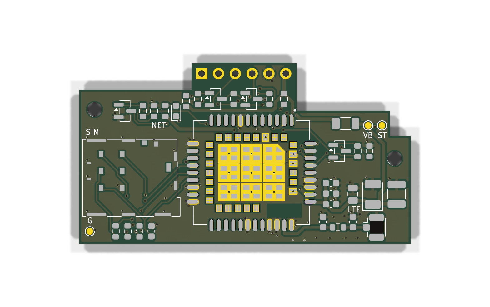
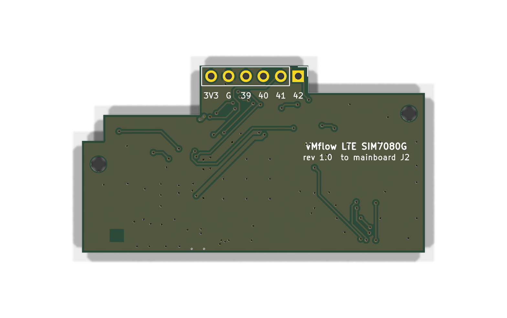

# LTE add-on module (SIM7080G) for the WROOM-1U board

Plug-in module that gives the [MDB ESP32-S3-WROOM-1U board](../mdb_slave_esp32s3-wroom-1u/)
an LTE-M / NB-IoT uplink. It sits on the mainboard's **J2** (1×6 JTAG socket) and
reuses the proven modem circuit of the [SIM7080G board](../mdb-slave-esp32s3-sim7080g/):
SIMCom SIM7080G, Nano-SIM, U.FL antenna connector.




## Status

- Revision **1.0**, not built yet — treat the first batch as a prototype.
- 4-layer board, 50 × 27.3 mm (with a 16 × 4 mm tab carrying the header).
- ERC: 1 known item (below). DRC: 0 errors, 0 warnings, 0 unconnected; schematic and PCB in sync.
- Fabrication files for JLCPCB in [`fab/`](fab/): gerber + drill zip, `BOM_JLCPCB.csv`, `CPL_JLCPCB.csv`.

## Connector (J1, male header on the bottom)

| J1 / mainboard J2 pin | ESP32-S3 | Function on the module |
|---|---|---|
| 1 | GPIO42 (MTMS) | DETECT — 10k pull-up to 3V3, so it reads HIGH when the module is plugged in |
| 2 | GPIO41 (MTDI) | PWRKEY — GPIO high turns Q3 on and pulls PWRKEY low (“press”) |
| 3 | GPIO40 (MTDO) | ESP TX → modem UART1_RXD (level shifter Q1) |
| 4 | GPIO39 (MTCK) | modem UART1_TXD → ESP RX (level shifter Q2) |
| 5 | GND | |
| 6 | +3V3 | modem supply (VBAT) via R1 |

The pin numbers are printed next to the header on the bottom silkscreen.

## Circuit

- **Supply**: VBAT is the mainboard's 3V3 rail through R1 (0 Ω, 1206), exactly like the
  SIM7080G board. SIM7080G accepts 2.7–4.8 V and only does LTE-M / NB-IoT (no 2G bursts),
  so the AP63201 on the mainboard (2 A) has enough headroom. C1 (220 µF low-ESR tantalum),
  C2 (100 µF), C3 (22 µF) and C4–C6 (100 nF / 33 pF / 10 pF) sit next to the VBAT pins and
  carry the TX bursts. Remove R1 and bridge it with an ammeter to measure the modem current.
  A local buck regulator from the MDB supply was considered and dropped: it does not fit next
  to the modem at this size, and an extra supply cable would not clear the case lid.
- **UART**: 3.3 V ↔ 1.8 V (VDD_EXT) level shifting with two MMBT3904 (Q1/Q2) and pull-ups
  R2–R5, the same topology as the SIM7080G board.
- **PWRKEY**: Q3 with R6 (4.7k base) and R7 (4.7k base-to-GND, keeps the modem off while
  GPIO41 floats during ESP reset). Polarity matches `MODEM_PWRKEY_INVERTED = 1`.
- **Nano-SIM**: JAE SF72S006, 22 Ω series resistors R12–R14, C7 on SIM_VDD.
- **Antenna**: 50 Ω line on F.Cu over the In1 ground plane (0.36 mm, JLC 4-layer stack-up),
  pi match R15 (0 Ω) + C8/C9 (not fitted), Hirose U.FL (J3). Use a U.FL → SMA bulkhead pigtail;
  the case needs a second SMA hole next to the WiFi antenna.
- **Status**: green network LED (D1, NETLIGHT via Q4), test points STATUS, VBAT, GND.
- GNSS and USB of the SIM7080G are not used.

## Assembly

- Solder a **1×6 male pin header on the bottom**, pins pointing down. On the mainboard J2
  takes a standard 8.5 mm female socket, which puts the module about 11 mm above the mainboard;
  the tallest part on top (SIM holder / modem) stays well under the 19 mm lid clearance.
- The outline keeps clear of the mainboard's tall parts (checked against their courtyards and
  silkscreen body outlines): about 0.6 mm to J1 (RFID cable), 0.4 mm to the I2C connector J3,
  1.0 mm to the custom-input terminal P2 (the top-right notch is for it), 0.85 mm to the screw terminals P3/P5/P6 along
  the bottom edge, 1.5 mm to the MDB connector. The buzzer sits under the module
  (3 mm tall, so 8 mm of air), which makes it a little quieter.
- H1/H2 (M2) take optional 11 mm nylon spacers resting on the mainboard; both land on bare
  board (H2 next to R18, clear of it with a 4 mm spacer).
- The modem pads carry via-in-pad ground vias: order **plugged / tented vias** (JLC “epoxy
  filled and capped”), otherwise solder wicks into them.
- J1, the test points and the mounting holes are not in the CPL (hand soldered / no part).

## Firmware

`mdb-slave-esp32s3` detects the module at boot: on the WROOM-1U board it reads GPIO42 with the
internal pull-down; HIGH selects GPIO39/40/41 as modem pins (`modem_set_pins()`) and the
normal cellular boot runs. Without the module the modem probe stays off, as before.

## Known ERC item

`power_pin_not_driven` on the SIM holder's VCC (J2 pin C1): SIM_VDD is driven by the modem's
SIM_VDD output, which the vendor symbol marks as a power pin. A PWR_FLAG would clash with that
output pin, so the item is left and only documented here.

## Regenerating

The design is generated from one source: [`scripts/design.py`](scripts/design.py) holds every part
and its pin-to-net map. Edit it, not the KiCad files. With KiCad 9 (e.g. the `kicad/kicad:9.0`
Docker image, which has `kicad-cli` and the pcbnew Python module):

```bash
cd kicad/lte-addon-sim7080g
docker run --rm -u 0 -v "$PWD":/p -w /p kicad/kicad:9.0 bash scripts/build.sh   # sch, place, route, DRC
docker run --rm -u 0 -v "$PWD":/p -w /p kicad/kicad:9.0 bash scripts/fab.sh     # gerbers, BOM, CPL, renders
```

| Script | Does |
|---|---|
| `gen_sch.py` | schematic from `design.py` |
| `gen_pcb.py place` / `finish` | outline, placement (mainboard coordinates, so J1 lands on J2), RF line, zones, silkscreen |
| `route.py` | grid router for all other nets plus ground fan-out and stitching |
| `fab.sh` / `jlc.py` | JLCPCB outputs |

The SIM7080G symbol and footprint (`lib/`) come from `../mdb-slave-esp32s3-sim7080g/SIM7080G.zip`.
The 3D renders show bare pads where the Docker image has no 3D models.
